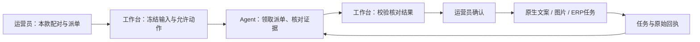

# 钧飞工作台与 Agent 协作审计

审计日期：2026-11-25。对象：`.` 当前工作区，包括尚未提交的优化；基础提交为 `a12d265`。本报告评价源码和隔离测试结果，不代表本机付费生图、真实采集或正式刊登验收。

## 1. 总体判断

**当前架构适合“Codex 编排、工作台执行、运营员在关键节点确认”的单款业务模式。原生任务的身份校验、证据和回执机制已有较好基础；主要短板是新旧入口衔接、异常退出以及跨模块接续体验。**

从本次代码检查和测试看，优先投入应是把已有模块连成可靠的业务闭环。当前不宜据此宣称已经具备多 Agent 共享浏览器、无人值守多店轮转或任意中断自动恢复能力。

最需要先解决的四个问题：

1. 采集插件的默认地址被自身校验拒绝，影响首次连接。
2. Codex 生图派单仍指向旧分镜，新图片引擎、技能脚本和正式图库交接没有统一契约。
3. 单张颜色变体有生成入口，但现有正式图库交接只接受逐色完整七图任务。
4. 轮转已分配商品如果在提交前被业务淘汰，没有保留历史且继续下一款的正式出口。

本轮只新增此报告，未修改业务源码，未启动真实生产任务，未清理原有未提交改动。

## 2. 当前系统如何与 Codex 等 Agent 协作

这里有两种不同的“Codex”：

| 角色 | 当前职责 | 应保持的边界 |
| --- | --- | --- |
| Codex 聊天或其他外部 Agent | 读技能、理解业务、检查证据、协调步骤、查询原任务 | 对话记忆不能替代业务数据库；新机器不继承历史授权 |
| 账号自己的 Codex Tools | 工作台内部调用的文案和图像服务 | 模型请求成功不等于商品质量合格或图库获批 |
| 工作台后端 | 原生任务、校验、质检、图库、ERP 交接及发布回执 | 执行动作前验证当前身份、输入和权限 |
| 运营员 | 核对目标、处理例外、确认正式交付与发布 | 发布和写入类恢复继续走明确确认 |
| 紫鸟 / EGO | 分别承担卖家后台与插件、工作台与 ERP 浏览器执行 | 实际登录账号、店铺、站点、目标 ID 必须与任务一致 |

现有 `codex_operations.py` 并非通用自治 Agent 引擎，而是受限协作协议：

它支持研究与文案、文案生成、图片生成、ERP 草稿采集和发布观察。配对 token 按账号、商品、站点限权；Agent 只能查询、交回核对结论和读取回执，不能凭此直接批准或发布。`agent_center.py` 主要是固定原生工具及任务执行器。

另一路是项目技能带领 Codex 使用脚本、当前登录页和原生 API。它覆盖了部分新图片能力，但与上述派单协议并非一套完整一致的入口。这是本次发现的协作割裂来源。

### 已有优化应当保留

- 派单核对输入、目标和证据；原生接单记录 `codex_handoffs` 与相应原生任务落库，用于处理响应丢失。
- 未知模型或 ERP 提交保留原任务，先查询、再决定后续动作，避免默认重发。
- 新增服装正式图库桥接已验证图序、颜色、真实子 SKU、源图、文件哈希及尺码数据，并让各色复用同一张尺码图。因此不能把现状概括为“没有图库交接”。
- 发布区分 ERP 草稿、真实发布中和在售观察；US-only 与已核对 US→UK 接续有分支和恢复检查。
- 轮转按原生发布回执计数，重复回执不重复累计；CLI 在售核验已增强原 SKU 和 ASIN 对账。
- 当前 Windows CI 已纳入轮转、正式图库交接等测试，是可继续扩展的回归基础。

## 3. 优先问题与具体建议

优先级含义：P1 为直接阻断核心路径，或扩展并发前必须解决；P2 为稳定性、维护和操作成本改进。以下区分“已复现”“代码确认”和“条件性风险”，不把推测写成已发生事故。

### A01 · P1 · 采集插件默认连接自相矛盾【已复现】

**证据：** [popup.js:1](studio-dev/listing-workbench/extension/popup.js#L1) 默认 `http://127.0.0.1:18769`，但第 2 行本机 HTTP 白名单只有 `18765`、`18775`；第 3 行又要求使用 `18769`。离线执行实际校验函数得到：18765=true、18769=false、18775=true，默认输入抛错。

**影响：** 用户按文档填默认地址仍无法配对，错误提示无法帮助纠正。扩展 manifest 中允许该端口，也不能消除脚本层面的拒绝。

**建议：** 立即统一本机连接策略；启动器、插件、CLI 和接续说明从同一配置或受信任的实例发现结果获取地址。保留对协议、主机、路径和凭据的检查，不应简单放开所有地址。

**验收：** 实际默认 URL 能通过插件校验并与隔离服务配对；非法 URL 仍被拒绝；测试检查行为，不只搜索默认字符串。

### A02 · P1 · Agent 生图、技能脚本与新引擎缺少统一接入【代码确认】

**证据：** [codex_operations.py:100](studio-dev/listing-workbench/codex_operations.py#L100) 从 `visual_studio.list_projects` 构造可派单图片动作；[第 564 行](studio-dev/listing-workbench/codex_operations.py#L564) 仍调用 `studio_bridge.render(projectId, indices...)`。该路径没有接入新引擎的 suite/variant 原生任务及正式交付状态。

[workbench_images.mjs:58](.agents/skills/junfei-product-images/scripts/workbench_images.mjs#L58) 组装请求时未传递 `sourceVariant`。Python 包装器正常流程会重新上传本地来源文件；现有正式图库要求真实颜色来源绑定。技能文件虽已说明应使用页面或 `prepare-variant-source` 获得绑定，但脚本没有提供统一的来源绑定操作。

**影响：** 仅使用新图片引擎的商品，Codex 协作区不能完整反映其可执行动作；旧项目仍可能引导到旧入口。技能能生成候选，不代表同一路径能完成正式交付。用户需要知道内部接口差异并手工接续。

**建议：** 新建版本化图片业务契约，让 UI、CLI、Agent 使用同一套“准备真实来源→提交原生任务→查询→质检→确认图库”服务。服务端根据当前商品和实际资产准备来源绑定；不能把旧 receiptId 直接套给重新上传的图片。旧项目可查询历史，新派单按明确规则迁移到当前正式引擎。

**验收：** 从只有新引擎任务的商品出发，Agent 可读取正确图位状态并提交允许的下一步；CLI/页面使用同一真实来源得到一致证据；更换源图、颜色或 SKU 后必须阻断过期绑定。

### A03 · P1 · 单图颜色变体不能进入现有正式图库交接【代码确认】

**证据：** [GeneratedColourVariant.tsx:27](studio-dev/listing-workbench/visual-ui/GeneratedColourVariant.tsx#L27) 创建 `mode=repair,count=1`，记录母版任务和图位。另一方面，[image_engine_delivery.py:42](studio-dev/listing-workbench/image_engine_delivery.py#L42) 只接收 `mode=suite`、固定七图顺序、完整质检及 `sourceVariant` 的任务；`_resolve` 要求每色选择一个完整套图任务。

**影响：** 使用页面“颜色变体”制作的单图，即使生成并过检，也不能通过当前套图交接入口组装为该色正式七图。现有按色完整 suite 的交付路径仍然有效；这里缺失的是单图派生、替换和组装路径。

**建议：** 引入“图库版本”，逐图记录母版任务、派生任务、图位、颜色、文件哈希、来源绑定和质检证据。允许用合格派生图替换指定图位，再整体检查六个商品图位与共同尺码图。确认后生成不可变交付清单供 ERP 消费。

**验收：** 首色七图→其他颜色六个派生图位→复用同一 SHA 尺码图→确认逐色图库→ERP 包预检可闭环；未过检、错色、失去来源依据、重复图位或被改动的文件必须拒绝。不可用放宽 suite 校验代替真实派生证据。

### A04 · P1 · 轮转缺少提交前淘汰和任务结束路径【代码确认】

**证据：** [store_rotation.py:91](studio-dev/listing-workbench/store_rotation.py#L91) 有当前商品时拒绝分配另一款；[第 155 行](studio-dev/listing-workbench/store_rotation.py#L155) 只接受 start/pause/resume/assign/reconcile。当前商品由已验证发布回执清空。每账号仅一个 run，已有不同配置时拒绝重新 start，没有结束、归档或安全变更目标的动作。

**触发：** 某款已分配，但在任何外部提交前发现断货、利润不合格或质检长期失败；运营决定淘汰该款。现有正式轮转接口不能释放当前位置继续下一款。

**建议：** 增加“提交前淘汰”状态和理由，服务端验证无进行中或未知外部副作用后，保留该款分配、身份排重及历史，不增加成功数，在同一店铺继续下一款。增加明确结束/归档及版本化目标配置，变更仅影响允许变更的后续位置。

**验收：** 提交前淘汰不计数；重复操作幂等；未知模型或 ERP 提交不能通过淘汰跳过；更改配置不丢已完成计数、原店铺绑定和原任务。

### A05 · P1（并发扩展前）· 共享浏览器协调器未覆盖生产适配器【条件性风险】

**证据：** [SHARED-BROWSER-SPACE.md:5](studio-dev/automation/SHARED-BROWSER-SPACE.md#L5) 明确协调器尚未由现有浏览器适配器统一执行；[接入清单](studio-dev/automation/SHARED-BROWSER-ADOPTION.md#L12) 描述多个直接执行边界。当前检索到的非测试接入 `discovery_live_coordinated.py` 明确为 OFFLINE ONLY fixture，不能证明生产路线已经协调。

**影响：** 多 Agent、多账号运行目录或不同工具共享同一个 EGO TaskSpace 时，局部任务锁不能保证共享浏览器互斥。尚未发现证据证明已发生串店发布，但不能以独立协调器测试通过声称此风险已消除。

**建议：** 所有真实浏览器适配器逐步接入共同执行边界，以实际浏览器运行环境与 TaskSpace 为资源身份，不能按工作台账号或 DATA 目录拆锁。持久化操作身份、派发意图和回执，阻止过期执行者继续写入。验证码、人工接管、未知提交继续保持阻断；租约超时不能自动抹去未知外部动作。

**验收：** 不同账号目录同时访问同一 TaskSpace，只允许一个执行者；进程崩溃、接管、响应丢失后不能通过换进程或换操作 ID 绕过原动作对账。实际适配器接入测试须独立于原语单元测试。

### A06 · P2 · Agent 会话与派单领取机制不利于稳定接续【代码确认】

**证据：** [codex_operations.py:26](studio-dev/listing-workbench/codex_operations.py#L26) token 有效期 1800 秒；[accounts.py:137](studio-dev/listing-workbench/accounts.py#L137) 同账号商品站点重新配对会删除旧 token。[next_assignment:432](studio-dev/listing-workbench/codex_operations.py#L432) 查询 assigned 任务但没有 Agent 身份或原子领取；两个使用同一 token 的 Agent 可读到同一份核对任务。

核对提交还比较工作区总 revision，因此无关商品的编辑也可能使原派单过期。UI 的协作区主要靠手动刷新；CLI 默认 18765，需另设 `JUNFEI_CODEX_URL` 才符合本机推荐 18769。

**影响：** 长任务中凭据过期、重新配对打断另一会话、重复核对和不必要重新派单增加操作成本。这里的重复领取不等于重复外部执行；现有后端派发保护应保留。

**建议：**

- 后端生成可复制的“接续包”：实例 ID、实际地址、账号/商品/站点、协议版本、原任务、检查点、允许的下一动作和阻断原因。长期保存的接续文件不携带长期明文密钥。
- 通过短期凭据交换、显式撤销及会话标识改善续接；给核对任务增加原子领取和心跳。领取超时只影响核对所有权，不能释放未知外部动作。
- 用商品及实际依赖摘要判断派单过期；仍要涵盖共享配置、店铺目标和发布策略变更。
- 对当前活动任务增加有界轮询或事件订阅，明确区分“没领取、核对中、待确认、执行中、需对账”。
- 在现有服务上增加轻量的 Agent 通用 CLI/MCP 外观，提供 JSON Schema、能力查询和结构化错误码；避免为不同 Agent 复制业务规则。

**验收：** 新聊天从原接续包能找到同一任务；重新配对行为可预期；无关商品编辑不误伤派单，关键输入变化仍阻断；两个核对 Agent 只会有一个有效领取者。

### A07 · P2 · 恢复信息分散，进程生命周期与业务生命周期耦合【代码确认与架构风险】

**证据：** [agent_center.py:145](studio-dev/listing-workbench/agent_center.py#L145) 根据进程内 ACTIVE 判断中断并转 needs_review；[第 1175 行](studio-dev/listing-workbench/agent_center.py#L1175) 明确不支持共享数据库多实例。任务由 daemon thread 执行。Agent、图片、ERP、发布、轮转、CLI 分别持久化状态，接续判断需要跨模块查询。

图片技能的本地描述文件使用 [workbench_images.mjs:12](.agents/skills/junfei-product-images/scripts/workbench_images.mjs#L12) 的直接 `writeFile`，Python 包装也直接 `write_text`；没有临时文件原子替换。崩溃窗口内描述文件可能损坏，影响找回原 requestId。后端幂等不能替代客户端原始身份的可靠保存。

**评价：** 当前恢复策略偏保守，优于无条件重跑；问题是恢复负担较多地落在用户和聊天上下文上，不能推断为“重启必然重复提交”。

**建议：** 在现有本地架构上增加持久任务监督器和统一的单款流程视图，关联各模块原任务 ID，无需立即拆微服务或重写所有数据库。任务派发使用可恢复操作日志/事务发件箱；原生模块仍保留事实回执。描述文件采用同目录临时文件、刷盘、原子替换及必要的并发保护。桌面备份复用现有 `cloud/backup.py` 的 SQLite backup 思路，同时验证数据库、资产及跨库关联可一起恢复。

**验收：** 在落意图前、落意图后、请求发出后、回执落库前后分别模拟崩溃；已确定未派发的本地步骤可继续，未知外部动作只查询原请求。重启后 UI 直接显示原任务和原因。生产执行限同一时刻一款，浏览器再按实际共享资源互斥。

### A08 · P2 · 安装说明、能力说明和测试准备存在漂移【代码及运行确认】

**证据：** 当前源码目录不存在规则引用的 `先看这里.txt` 及 `tools/env.cmd`；根 README 已区分源码与笔记本试跑包，但 AGENTS 和部分子目录说明仍混用分发包路径、旧启动信息。源码 CLI 默认 18765，推荐启动为 18769。启动器本身支持 `JUNFEI_PORT`，因此不应把问题归因于它忽略配置。

干净环境下部分 automation 测试依赖尚未存在的 `config.json`；CI 显式从示例复制，直接本地运行则报错。当前核心新增交付/轮转模块和对应前端、测试文件仍未跟踪，发布前需要纳入一致源码与构建清单。

**建议：** 区分源码和便携分发的首读入口；提供只读诊断命令，输出实例、数据目录、实际端口、浏览器绑定、模板/权重资源、依赖版本及可用能力，不启动付费动作。由一份能力清单生成关键接续说明，并检查技能引用的命令真实存在。测试配置在隔离夹具中生成；发布工件必须包含新增模块和匹配的前端构建。

**验收：** 新目录按一份说明完成诊断和离线回归；资源缺失指向准确修复步骤；源码、构建包、技能与 API 版本互相匹配；测试不读取真实账号配置。

## 4. 建议的使用体验与业务状态

商品页应始终给出四项信息：**当前步骤、阻断原因、下一项允许动作、原任务与回执**。用户不应通过对照多个面板或重新讲述聊天历史才能判断是否可以继续。

建议围绕同一商品建立统一流程视图：

> 选品事实核对 → 采购/包装/利润核对 → 文案 → 首色与逐色图片 → 正式图库确认 → ERP 草稿 → 发布确认 → 原任务观察 → 轮转对账。

这是建议的上层视图，各模块原有任务和状态仍是事实来源。尤其不能把“生成完成”“正式图库获批”“ERP 草稿保存”“发布中”“在售”合成同一个绿色完成状态。轮转按配置目标的真实发布中回执计数，在售核验单独展示。

具体交互建议：

| 用户场景 | 建议操作 | 后端约束 |
| --- | --- | --- |
| 首次使用 | “检查本机环境” | 只读检查，不自动采集或付费 |
| 交给 Agent | “复制本款接续信息” | 自动填实际实例和原任务，不携带旧机授权 |
| 聊天或工作台中断 | “继续原任务” | 先对账并显示原 requestId / 外部 ID |
| 质检失败 | 定位失败图位与原因 | 生成修订版本，保留旧图和证据 |
| 商品提交前淘汰 | “淘汰本款，保留轮转位置” | 确认无未知外部效果，不增加计数 |
| 遇到验证码 | “等待人工接管” | 自动执行停止，接管完成后重新核对身份 |
| 正式发布 | 展示店铺、站点、SKU、图库版本的确认摘要 | 保留本机明确授权及现有密码/预检约束 |

预算也需清晰区分“估算、已预留、已结算、未知”。当前研究文案的能力说明明确写着“预算仅记录”，相关确认也承认不是硬上限；不可在总控界面暗示已有自动止损保证。可取得报价的调用应先预留额度，未知计费请求保留预留并阻止无依据的新请求；无法获得实际账单的部分明确标识。

## 5. 推荐实施顺序与验收门槛

### 第一批：修通现有单款路径

- 修复插件端口校验，统一实例连接信息。
- 将 Codex 图片动作对齐当前引擎，补齐真实来源绑定及单图派生图库交付。
- 增加提交前淘汰及轮转结束/归档。
- 增加对应跨模块契约测试，核查新增文件和前端构建可打包。

**门槛：** 隔离环境中完整跑通两色商品、共享尺码图、ERP 交付预检及三款切店回执模拟；另跑淘汰、未知提交、中断接续，不调用真实收费服务。

### 第二批：降低接续和维护成本

- 统一流程视图、接续包、原任务查询和结构化阻断原因。
- 图片接续文件原子保存、只读诊断、可恢复备份。
- 优化 token 会话与派单领取、依赖摘要和状态自动刷新。

**门槛：** 新聊天和重启均从原检查点继续；用户无需手动寻找内部数据库或修改布尔状态；环境和资源问题能一次诊断定位。

### 第三批：扩展并发前补齐执行基础

- 真实浏览器适配器接入共享协调器。
- 持久任务监督、明确单款执行和资源并发限制。
- 覆盖多账号争用、进程崩溃、人工接管、未知响应与过期执行者的故障测试。

**门槛：** 通过真实适配器的隔离协调测试后再评估多 Agent；真实业务验收另按本机授权逐步进行。不能用 TTL 过期自动重发或降低质量门槛来获得通过率。

可持续记录的指标包括：首次连接成功率、从重启到恢复原任务所需操作数、未知提交待核对数量与停留时间、派单误过期率、图片从合格候选到正式图库的成功率、重复回执重复计数次数。先收集基线，再设目标；本次没有编造生产指标。

## 6. 验证结果与边界

| 验证范围 | 本次结果 | 说明 |
| --- | --- | --- |
| Codex 协作、Agent API/交接、轮转配置/执行、图库交接、发布流程/API/恢复，共 9 个 Python 模块 | 113 项通过 | 隔离临时数据与示例配置，真实服务模拟；本机 HTTP 在允许的执行环境中验证 |
| shared_browser_space、ego_browser_binding、ziniao_plugin、workbench_batch、budget_carryover | 86 项通过 | 离线自动化子集；不代表生产适配器已接入共享协调 |
| ego-publication-workflow 与 existing-draft-attributes | 21 项通过 | 其中属性 DOM 使用临时无头 Edge 合成页面，页面网络请求拦截；未访问真实 ERP |
| visual-ui TypeScript `tsc --noEmit` | 通过 | 类型检查，不替代完整打包及页面业务验收 |
| 后端与 automation Python compileall | 通过 | 语法检查 |
| 采集插件默认 URL 校验 | 复现拒绝 18769 | 属于确认的实现缺陷 |

以上三组重点回归合计 **220 项通过**。不代表全仓库测试全部通过。

其他执行记录：

- 初次核心测试遭沙箱本机网络限制及缺少示例配置；在临时配置、允许 loopback 后，上述 113 项通过。初次 Edge 启动受限，隔离重跑后上述 21 项通过。未把这些环境限制当成业务缺陷。
- 全量 automation 初跑共 159 项，有 28 个错误源于缺少 `config.json`，另 1 个失败是 Windows 临时路径中 `!` 的 URI 编码与 Node stack 表示不同造成的路径字符串断言问题。未宣称该全量套件通过；建议测试比较规范化路径身份。
- visual-ui 没有 `npm test` 脚本，不能以该命令验证 UI。CI 的实际入口是构建和工作台 Node 测试，本次前端仅报告已完成的类型检查。
- 未执行付费文本/图片、1688 真实详情采集、GPU 实际出图、ERP 草稿写入或真实刊登，未核实本机所有店铺登录与资源完整性。上述生产验收须与本次代码审计分开记录。

本报告的判断以当前工作区为准；后续代码变更后应按各项验收条件重新验证，不沿用本次通过结果代替新版本验收。
